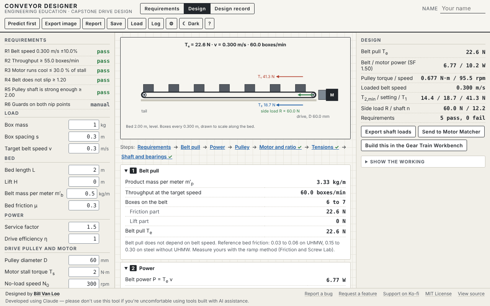

# Conveyor Designer

The capstone tool for the unit. Teams enter their requirements, then step through the design in the unit's order: belt pull, power, drive pulley, motor and ratio, belt tensions and slip, pulley shaft and bearings. Every requirement shows pass or fail as the numbers change, and the tool prints a design record that serves as the team's calculation package.

Part of **[Engineered by the Numbers](https://github.com/billvanloo/EngineeredByTheNumbers)**, a Principles of Engineering unit (module 5, the capstone).



## Quick start

**Online:** enable GitHub Pages for this repo (Settings → Pages → Deploy from a branch → `main`, `/ (root)`) and share the URL.

**Offline:** download `index.html` and open it in any current browser. It's one self-contained file with no network calls, and works on a Chromebook.

## What teams do

- **Requirements tab.** Turn the brief into numbered, measurable requirements. Each row has a quantity (belt speed, throughput, box mass, length, lift, motor duty, slip margin, shaft safety factor, motor power margin, or custom), a check (target ± tolerance, at least, or at most) and a target. Rows show pass, fail or manual as the design changes. **Add the example requirements** starts from the mockup's six rows.
- **Design tab.**
  - A side view, to scale along the bed: boxes moving at the loaded belt speed, both pulleys, the motor, the incline, T₁ and T₂, the side load, and a "belt will slip" mark when the tension is too low.
  - One collapsible section per design step, each with its outputs and its own Check in predict-first mode. A step strip shows which steps have failing requirements.
  - **Belt pull** for a slider bed (friction and lift parts), **power** with the service factor, **pulley** torque and speed, **motor and ratio** (the Motor and Drive Matcher's model, with the operating point, duty band, both ratio roots and a torque-speed plot; or your own ratio), **tensions** (capstan slip limit, minimum slack-side tension, your setting), and the **pulley shaft** (side load, the Shaft and Beam Workbench's Tresca check, bearing loads).
  - On an incline, a flag and the backward pull with the power off.
- **Design record tab.** Prints on letter paper: the requirements table first, then the side view, every input and result with its unit, each step's working in order, the prediction history and the sources.
- **Predict first.** T<sub>e</sub>, P, N<sub>p</sub>, T<sub>2,min</sub>, R and n, one Check per design step, so a team predicts the belt pull before it sees the power. Every attempt goes to the prediction log.
- **Saving and exports.** Save and Load design files (requirements included); export a PNG (2×, ink on paper, with a caption); export the prediction log (JSON or CSV).

## Teacher notes

- **Placeholders.** The shaft yield strength starts at 400 MPa and is flagged as a placeholder until the team enters a datasheet value. The motor starts as the example motor from the Motor and Drive Matcher (2 N·m, 300 rpm).
- **Bed friction.** The help gives PackagingConveyor.com's reference ranges (0.03 to 0.06 on UHMW, 0.15 to 0.30 on steel) and asks teams to measure μ with the ramp method in the Friction and Screw Lab.
- **Choices to review.** These are in the curriculum repo's `QUESTIONS.md`:
  - The motor power margin uses the motor's maximum power, T<sub>s</sub>ω<sub>0</sub>/4 (Q19).
  - One drive efficiency η is used for both the power and the gearbox (Q20).
  - Requirements have a check type (Q21).
  - The shaft-loads file points the side load along the belt, toward the tail (Q22).
  - Throughput requirements use the loaded belt speed (Q35).
- **CD-5.** The spec's CD-5 and CD-6 use rounded linked values (0.68 N·m, 95.5 rpm). With full precision the tool shows 84.1 rpm and a −11.9% speed error instead of 84.0 rpm and −12.0%. The tests use the table values (ERRATA).
- **Not in version 1:** roller-bed or troughed bulk conveyors (the CEMA method), multiple drives, snub pulleys, start-up acceleration forces and belt selection by strength rating. The help panel names these as what industrial design adds.

## How it connects to the other tools

| File | Direction |
|---|---|
| `shaft-loads` JSON | **Out** ("Export shaft loads"): the side load and pulley torque, for the Shaft and Beam Workbench |
| `drive-request` JSON | **Out** ("Send to Motor Matcher"): pulley torque, pulley speed as the target, the ratio and the motor. "Build this in the Gear Train Workbench" saves the same file for when that tool's upgrade lands |
| `drive-result` JSON | **In**, through Load: the Motor and Drive Matcher's motor, ratio and efficiency |
| `prediction-log` JSON/CSV | **Out**, to the Prediction Log Collector |

The formats are documented in [`EngineeredByTheNumbers/ecosystem/schemas.md`](https://github.com/billvanloo/EngineeredByTheNumbers/blob/main/ecosystem/schemas.md).

## Development

```
node dev/test.js          # 80 checks: every spec test case CD-1 to CD-10, the shared fixtures, requirements and files
node dev/verify-html.js   # inline code in index.html matches dev/core.js and dev/vendor/; runs spec cases on it
node dev/e2e.js           # 121 browser checks in headless Chromium (needs Playwright, see below)
```

- **Where the code lives.** `dev/core.js` is the conveyor's own calculation layer. The motor and shaft models are the shared `motor-core.js` and `beam-core.js`, vendored unchanged in `dev/vendor/`. `dev/vendor/conveyor-shared.json` holds the shared fixtures: `dev/test.js` checks that the conveyor's results for them are the same numbers MotorCore and BeamCore give, and the EngineeredByTheNumbers ecosystem tests check the cores against the same file (spec 05 §9). Don't edit vendored files here. Change them in the EngineeredByTheNumbers repo and run its `scripts/sync-vendor.js`.
- **Cross-tool checks.** `dev/e2e.js` loads the exported shaft-loads file into the real Shaft and Beam Workbench (CD-10), and sends a drive request through the real Motor and Drive Matcher and back. These run when those repos are checked out next to this one, and are skipped with a message otherwise.
- **Changing the core.** Edit `dev/core.js`, run `node dev/test.js`, then `node dev/verify-html.js --fix` to copy it into `index.html`.
- **Playwright for the e2e checks.** It isn't a project dependency. Once, from the repo root: `npm i --no-save playwright && npx playwright install chromium`. You can also set `CHROMIUM_PATH` to an installed Chromium.

The spec this tool was built from is in [`docs/spec.md`](docs/spec.md), with the shared conventions in [`docs/conventions.md`](docs/conventions.md).

This was built using Claude. Please don't use this tool if you have qualms about using code created with AI tools.
